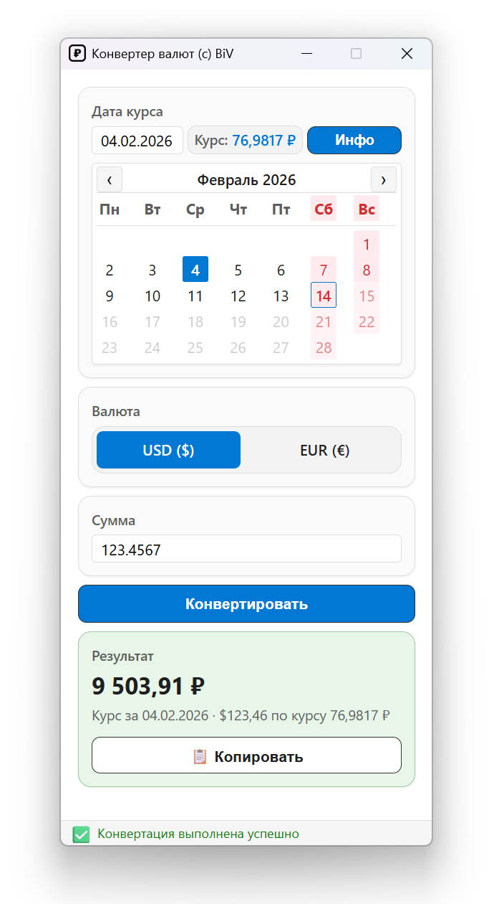
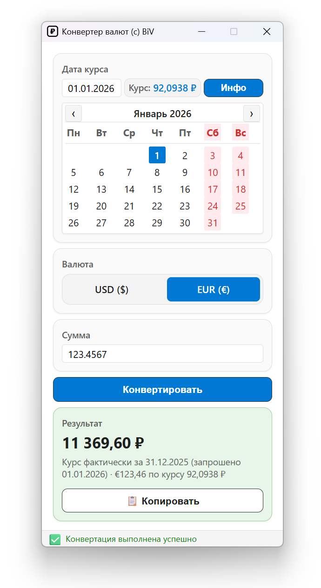

# CurRate-Go 🔄

> **Конвертер валют на основе официальных курсов ЦБ РФ**  
> Go реализация проекта [CurRate](https://github.com/bivlked/CurRate) с современной архитектурой, XML API и desktop UI

[](https://github.com/bivlked/CurRate-Go/actions/workflows/build.yml)
[](https://github.com/bivlked/CurRate-Go/actions/workflows/test.yml)
[](https://github.com/bivlked/CurRate-Go/actions/workflows/lint.yml)
[](https://github.com/bivlked/CurRate-Go/actions/workflows/security.yml)
[](https://github.com/bivlked/CurRate-Go/releases/latest)
[](https://github.com/bivlked/CurRate-Go/releases)
[](https://go.dev/)
[](LICENSE)
[](https://github.com/bivlked/CurRate-Go)
[](https://goreportcard.com/report/github.com/bivlked/CurRate-Go)

<div align="center">
  
  &nbsp;&nbsp;
  
</div>

---

## 📋 О проекте

**CurRate-Go** - это высокопроизводительный конвертер валют, написанный на Go, который получает актуальные курсы валют с официального XML API Центрального Банка России. Проект является функциональной миграцией Python-версии [CurRate](https://github.com/bivlked/CurRate) v3.0.0 с улучшенной архитектурой и производительностью.

### ✨ Ключевые особенности

- 🚀 **Высокая производительность**: ~5-10 мс на запрос (в 10 раз быстрее HTML парсинга)
- 🔒 **Надежность**: Официальный XML API ЦБ РФ вместо HTML scraping
- 💾 **Умное кэширование**: LRU кэш с TTL для минимизации запросов
- 🔄 **Retry логика**: Exponential backoff (1s, 2s, 4s) для отказоустойчивости
- 🌐 **Поддержка кодировок**: Автоматическая конвертация windows-1251 → UTF-8
- 🧪 **>90% покрытие тестами**: Unit + интеграционные тесты
- 📱 **Современный UI**: Desktop приложение на Wails v2 с карточным дизайном Windows 11

---

## 🚀 Быстрый старт

### Требования

- **Go 1.26** - [Скачать](https://go.dev/dl/)
- **Git** - [Скачать](https://git-scm.com/)
- (Опционально) **Wails CLI** для сборки desktop UI - [Установка](https://wails.io/docs/gettingstarted/installation)

### Установка

```bash
# Клонировать репозиторий
git clone https://github.com/bivlked/CurRate-Go.git
cd CurRate-Go

# Установить зависимости
go mod download

# Запустить тесты
go test ./...

# Запустить desktop приложение (режим разработки)
wails dev

# Собрать desktop приложение для production
wails build
```

### Первый запуск (GUI)

1. Запустите приложение: `wails dev` (режим разработки) или `build/bin/CurRate.exe` (production)
2. Выберите дату в календаре или введите вручную (формат: ДД.ММ.ГГГГ)
3. Выберите валюту: USD или EUR
4. Введите сумму для конвертации
5. Нажмите "Конвертировать"
6. Результат отобразится в формате: `"80 722,00 руб. ($1 000,00 по курсу 80,7220)"`
7. Используйте кнопку "Копировать в буфер" для копирования результата

> **⚠️ Примечание о Windows SmartScreen:**
> При первом запуске Windows может показать предупреждение "Windows защитила ваш компьютер". Это нормально для новых приложений без коммерческой подписи. Нажмите **"Подробнее"** → **"Выполнить в любом случае"**. Приложение безопасно — исходный код полностью открыт.

**Подробнее:** См. [Руководство пользователя](docs/09-WAILS-GUI-РУКОВОДСТВО-ПОЛЬЗОВАТЕЛЯ.md)

> **💡 Примечание для разработчиков:**
> CurRate-Go - это desktop приложение. Для использования программы установите `.exe` файл или запустите через `wails dev`.
> Если вы хотите расширить функциональность или создать свою версию, см. [Руководство разработчика](docs/10-WAILS-GUI-РУКОВОДСТВО-РАЗРАБОТЧИКА.md) и [API документацию](docs/11-WAILS-GUI-API-ДОКУМЕНТАЦИЯ.md).

---

## 🖥️ Desktop GUI

**CurRate-Go Desktop** - это современное настольное приложение с графическим интерфейсом, построенное на Wails v2.11.0.

### Ключевые особенности GUI

- 🎨 **Интуитивный интерфейс** - простой и понятный дизайн в одном окне
- 📅 **Визуальный календарь** - выбор даты с автоматическим выделением выходных красным цветом
- ⌨️ **Ручной ввод даты** - альтернатива календарю для быстрого ввода
- 💱 **Выбор валюты** - радиокнопки для USD/EUR
- 📋 **Копирование в буфер** - результат одним кликом
- ⚡ **Мгновенные результаты** - благодаря LRU кэшу
- 💾 **Компактный размер** - всего ~8-10 МБ (с UPX компрессией)
- ℹ️ **Информация о программе** - модальное окно с информацией об авторе и версии
- ⭐ **Обратная связь** - возможность "послать звезду" автору через Telegram

**Статус:** ✅ Реализовано и готово к использованию

**Документация:**
- [Руководство пользователя](docs/09-WAILS-GUI-РУКОВОДСТВО-ПОЛЬЗОВАТЕЛЯ.md) - Как использовать приложение
- [Руководство разработчика](docs/10-WAILS-GUI-РУКОВОДСТВО-РАЗРАБОТЧИКА.md) - Как разрабатывать и собирать
- [API документация](docs/11-WAILS-GUI-API-ДОКУМЕНТАЦИЯ.md) - Справочник по API
- [Архитектура GUI](docs/12-WAILS-GUI-АРХИТЕКТУРА.md) - Архитектурный дизайн

---

## 📚 Документация

Полная техническая документация доступна в папке `docs/`:

### Основные документы

- **[Архитектура](docs/ARCHITECTURE.md)** - Архитектура системы, слои, потоки данных
- **[Производительность](docs/PERFORMANCE.md)** - Benchmarks, оптимизации, сравнение
- **[Тестирование](docs/TESTING.md)** - Покрытие тестами, запуск тестов, best practices
- **[Roadmap](docs/ROADMAP.md)** - Планы развития и этапы разработки

### Backend & Core

- **[Техническое задание](docs/01-ТЕХНИЧЕСКОЕ-ЗАДАНИЕ.md)** - Требования и спецификации
- **[Технологический стек](docs/02-ТЕХНОЛОГИЧЕСКИЙ-СТЕК.md)** - Технологии и зависимости
- **[Архитектурный дизайн](docs/03-АРХИТЕКТУРНЫЙ-ДИЗАЙН.md)** - Детальная архитектура
- **[План разработки](docs/04-ПЛАН-РАЗРАБОТКИ.md)** - Этапы и прогресс

### Desktop GUI (Wails v2)

- **[Руководство пользователя](docs/09-WAILS-GUI-РУКОВОДСТВО-ПОЛЬЗОВАТЕЛЯ.md)** - Как использовать приложение
- **[Руководство разработчика](docs/10-WAILS-GUI-РУКОВОДСТВО-РАЗРАБОТЧИКА.md)** - Как разрабатывать и собирать
- **[API документация](docs/11-WAILS-GUI-API-ДОКУМЕНТАЦИЯ.md)** - Справочник API (Go ↔ JavaScript)
- **[Архитектура GUI](docs/12-WAILS-GUI-АРХИТЕКТУРА.md)** - Архитектурный дизайн GUI

### Безопасность и подпись кода

- **[SignPath Code Signing](docs/13-SIGNPATH-CODE-SIGNING.md)** - Настройка подписи кода через SignPath Foundation

---

## 🤝 Contributing

Мы рады вашему вкладу! См. **[CONTRIBUTING.md](CONTRIBUTING.md)** для подробной информации о:

- Настройке окружения разработки
- Стандартах кода (Go, JavaScript)
- Процессе создания Pull Request
- Требованиях к коммитам (Conventional Commits)
- Процессе ревью кода
- Тестировании и покрытии тестами

**Быстрый старт для контрибьюторов:**

1. Fork проекта
2. Создайте feature branch (`git checkout -b feature/AmazingFeature`)
3. Внесите изменения и следуйте стандартам проекта
4. Запустите тесты (`go test ./...`)
5. Commit изменения с conventional commits (`git commit -m 'feat: add AmazingFeature'`)
6. Push в branch (`git push origin feature/AmazingFeature`)
7. Откройте Pull Request

---

## 🔒 Security

Если вы обнаружили уязвимость безопасности, пожалуйста, **не создавайте публичный Issue**. Вместо этого ознакомьтесь с нашей **[Политикой безопасности](SECURITY.md)** и сообщите об уязвимости ответственно.

**Важно:** Мы серьезно относимся к безопасности и благодарим всех, кто сообщает об уязвимостях ответственно.

---

## 📝 История изменений

См. [CHANGELOG.md](CHANGELOG.md) для подробной истории изменений.

**Последние обновления:**
- **v1.2.1** (2026-10-23) - Точное округление до копеек, исправления интерфейса и сборки, Wails 2.17
- **v1.2.0** (2026-02-14) - Аудит кода, укрепление надежности, пропагация context.Context
- **v1.1.0** (2026-01-11) - Новый UI, модальное окно "О программе", интеграция с Telegram
- **v1.0.0** (2025-12-25) - Первый стабильный релиз с полным функционалом

---

## 🔗 Связанные проекты

- **[CurRate (Python)](https://github.com/bivlked/CurRate)** - Оригинальная версия на Python
- **[ЦБ РФ API](https://www.cbr.ru/scripts/XML_daily.asp)** - Официальный API курсов валют

---

## 👨‍💻 Автор

**Иван Бондарев** ([@bivlked](https://github.com/bivlked))

- Компания: New Digital Technologies Ltd.
- Местоположение: Казахстан
- GitHub: [@bivlked](https://github.com/bivlked)

---

## 📄 Лицензия

Этот проект лицензирован под **MIT License** - см. файл [LICENSE](LICENSE) для деталей.

---

## 🔏 Code Signing Policy

Бесплатная подпись кода предоставлена [SignPath Foundation](https://signpath.org/) в рамках программы поддержки Open Source проектов.

**Политика подписи:**
- Все официальные релизы подписаны сертификатом SignPath Foundation
- Подпись создается автоматически в доверенной среде сборки (GitHub Actions)
- Origin verification гарантирует, что подписанные файлы соответствуют исходному коду в репозитории

[](https://signpath.org/)

---

## 🙏 Благодарности

- **Центральный Банк РФ** за предоставление публичного API курсов валют
- **Wails Team** за отличный фреймворк для Go desktop приложений
- **Go Team** за великолепный язык и стандартную библиотеку
- **[SignPath Foundation](https://signpath.org/)** за бесплатную подпись кода для Open Source
- Сообщество **Go** за вдохновение и best practices

---

<div align="center">

**Сделано с ❤️ используя Go**

[⬆ Наверх](#currate-go-)

</div>
